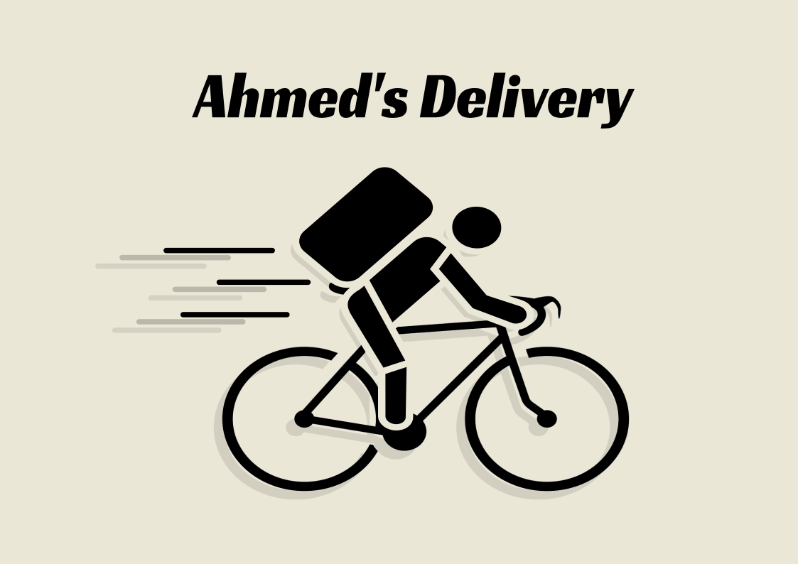

+++++++++++++++++head
.title: Ahmed's Delivery Service
.author: samiulahmed
.description: This page gives info on Ahmed's Delivery Services
.style: ./css/maind.css
.style: ./css/main.css
.name-generator: This page gives info in Ahmed's Delivery Services
.canonical-link: https://samiuljoy.github.io/delivery.html
-------------------head

++++navigation
.homepage: [home](./index.html)
.navmenu: roam
.navpage: [demo](./demo/base.html)
.navpage: [microblog](./microblog/base.html)
.navpage: [projects](projects/base.html)
.navpage: [academics](academics/base.html)
.navpage: [theology](theology/base.html)
.backpage: [delivery](./delivery.html)
----------navigation

++++++++++++++++main
.ce header2: Ahmed's Delivery

As Salamu Alaikum. Welcome to Ahmed's Delivery Service's info page. We are a startup cycle-based delivery service inside Chittagong city. We ensure reliable, on-time delivery inside Chittagong city.

### # The Reasoning

With the recent increase in traffic inside Chittagong city, mundane delivery tasks through four-wheeled vehicles(truck, van, car) that used to take around 15-20 minutes from G.E.C. to Oxygen nowadays takes around an hour or more. Cycle being a two-wheeled vehicle makes it very easy to cut through stagnant traffic and deliver products within a reasonable time. We conducted an experiment to compare delivery times between four-wheeled and two-wheeled vehicles during peak traffic hours. Our result suggest that, a cycle is by far more efficient in delivering on time(within reasonable distance) compared to a four-wheeled vehicle during peak hours.

### # What items/packages do we deliver?

We deliver anything that's not above 5 kg. Anything below 5 kg is eligible for our riders to deliver. We also do not deliver glass bottle/drinks as they are more prone to breaking/spilliage. Our delivery items include(but not limited to);

#. Any Official Documents

#. Food/Eating Items(no open drinks)

#. Anything non-fragile

#. Medicine Items

#. Groccery Items

 **Note: We also do not deliver packages/items worth more than 50,000 taka**

### # Working Hours

Our members(including myself) are currently employed/working at different jobs. So, below are our currently available delivery times;

#. 9 am to 9:30 pm - Friday

#. 3 pm to 9:30 pm - Sunday, Tuesday

#. 3 pm to 5:30 pm - Saturday, Monday, Wednesday, Thursday

### # Our Pricings and Delivery Areas

 **TK 50 delivery charge** for any region that's within **6 km radius from our current rider's position**. Anything after that, we add **TK 20 per extra 1 Kilometer**. Our delivery region is mainly city centered. Anything that's within 12 km range from G.E.C. is eligible for delivery.

 __Note: We also do not deliver to or from any region that's on the other side/opposite side of Karnaphuli river.__

### # Why not a bike/motorcycle?

Below is a simple comparison between cycle and motorbike delivery

++++++++++table

.th: Criteria
.th: Bicycle
.th: Motorbike

.td: Cost
.td: Low maintenance fee, no fuel, no insurance, no license
.td: Requires maintenance fee, fuel, insurance and license

.td: Dexterity
.td: Cycles can slip through congestions, use walking lane/footpath
.td: Bikes can not follow up with that kind of dexterity

.td: Parking Fee
.td: No parking fee
.td: A general parking fee is required

.td: Environment Friendly
.td: Yes
.td: No

.td: Long Distance Delivery
.td: No
.td: Yes

.td: Heavy Load Deliveries
.td: No
.td: Yes

----------------table

.caption: Table: A comparitive Table

We are eager to hear from you and hope that you include us in your projects

.hr
----------------main

++++++++++++++++footer
.message: Made with <3 by [samiulahmed](https://github.com/samiuljoy) using [ssg](https://github.com/samiuljoy/ssg)
------------------footer

+++++++script
mode = document.getElementById('switch');

if (! navigator.cookieEnabled) {
	mode.style.display = 'none';
}
else if(! localStorage) {
	mode.style.display = 'none';
}
else {
	mode.style.display = 'inline';
}
-----------------script

+++++++++add
.script: ./js/toggle.js
-----------add
